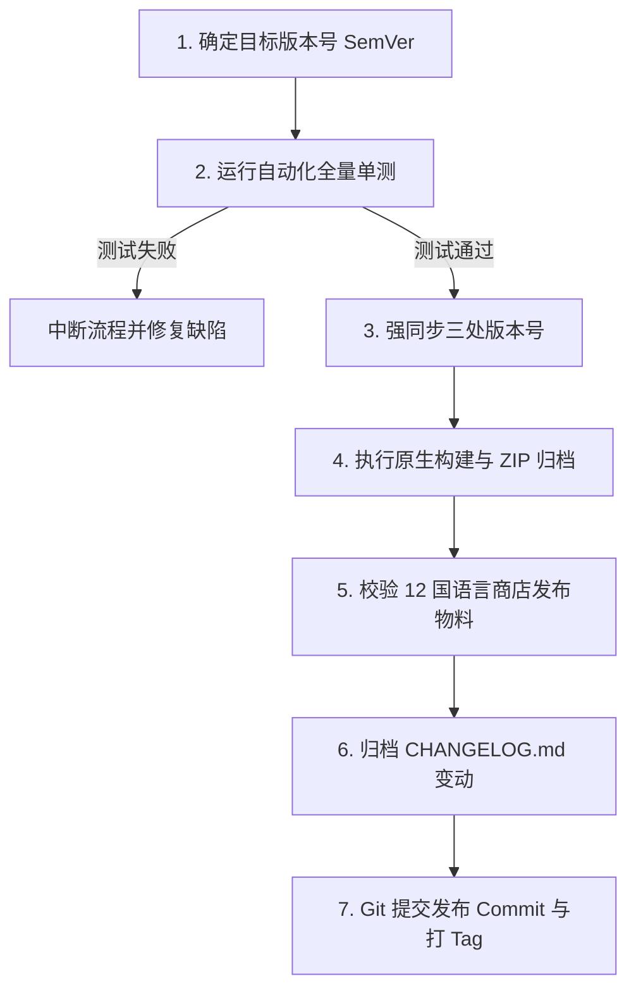

# History Guard 发版与应用商店打包工作流 (Release & Packaging SOP)

本 Skill 是 **History Guard** 项目执行正式版本发布、产物校验与商店归档的标准操作指南（Runbook）。当用户请求发版、打包或提升版本号时，必须按以下步骤顺序严格执行。

---

## 阶段流程总览



---

## 具体执行步骤

### 步骤 1：确定目标版本号
根据 [SemVer 规范](https://semver.org/lang/zh-CN/) 与用户确认新版本号：
- **Patch (补丁版本，如 1.0.0 -> 1.0.1)**：仅包含向后兼容的缺陷修复（Bug Fixes）与样式调优；
- **Minor (次版本，如 1.0.0 -> 1.1.0)**：包含向后兼容的新增功能特性（Features）；
- **Major (主版本，如 1.0.0 -> 2.0.0)**：包含重大架构重构或不兼容变更。

### 步骤 2：执行自动化质量门禁
发版前**必须**运行全量单元测试，测试失败严禁发版：
```powershell
& "D:\nodejs\node.exe" --test tests/*.test.js
```
* 确认控制台输出 `fail 0`；
* 详细门禁要求可参阅 [release.md](../../rules/release.md)。

### 步骤 3：严格同步三处版本号 (Triple-Sync)
同步修改以下 3 个文件中的版本字段，确保三者完全一致：
1. [package.json](../../../package.json) 中的 `"version"`
2. [manifest.chrome.json](../../../manifest.chrome.json) 中的 `"version"`
3. [manifest.firefox.json](../../../manifest.firefox.json) 中的 `"version"`

### 步骤 4：执行构建与生成商店 ZIP 归档包
运行原生构建与打包工具：
```powershell
# 1. 编译输出 Chromium 与 Gecko 产物至 dist/chrome 与 dist/firefox
& "D:\nodejs\node.exe" build.js

# 2. 自动化生成符合商店规范的 ZIP 归档包至 dist/releases/
& "D:\nodejs\node.exe" package.js
```
* 验证生成产物：
  - `dist/releases/history-guard-chrome-v<version>.zip`（用于 Chrome Web Store）
  - `dist/releases/history-guard-firefox-v<version>.zip`（用于 Firefox AMO）
* 产物内根目录直接为 `manifest.json`，无多余父层文件夹。

### 步骤 5：校验应用商店上架物料 (Publish Assets)
检查 `dist/Publish/` 目录：
- 确认包含全部 12 种主流语言子目录（`简体中文`、`繁体中文`、`英语`、`法语`、`德语`、`日语`、`韩语`、`西班牙语`、`葡萄牙语`、`俄语`、`印尼语`、`阿拉伯语`）；
- 确认各语言目录下的 `description.md`、`Overview.md`、`keywords.md` 与截图均完备；
- 确认 `promo-1400x560.png`、`promo-440x280.png` 与 `Permission.md` 存在。

### 步骤 6：归档 CHANGELOG.md
1. 打开 [CHANGELOG.md](../../../CHANGELOG.md)；
2. 将顶部的 `## [Unreleased]` 区块重命名并整理归档为新版本发布记录：
   ```markdown
   ## [X.Y.Z] - YYYY-MM-DD

   ### Added
   - 新增功能描述...

   ### Fixed
   - 修复问题描述...
   ```
3. 在顶部重新补充一个空的 `## [Unreleased]` 占位，供下一个版本累积使用。

### 步骤 7：Git 提交流程与打标
执行标准发布提交与 Tag 打标：
```powershell
& "d:\Git\cmd\git.exe" add package.json manifest.chrome.json manifest.firefox.json CHANGELOG.md dist/
& "d:\Git\cmd\git.exe" commit -m "chore(release): bump version to X.Y.Z"
& "d:\Git\cmd\git.exe" tag -a "vX.Y.Z" -m "Release vX.Y.Z"
```

### 步骤 8：推送至 GitHub 触发云端自动化流水线 (CI/CD)
将本地提交与发布 Tag 推送至远程仓库，GitHub Actions 将全自动执行质量门禁、生成 GitHub Releases 下载包，并根据配置自动推送至 Chrome / Firefox / Edge 应用商店：
```powershell
& "d:\Git\cmd\git.exe" push origin master
& "d:\Git\cmd\git.exe" push origin vX.Y.Z
```
* 详细的商店发布密钥配置可参阅 [SECRETS_GUIDE.md](../../../.github/SECRETS_GUIDE.md)。

