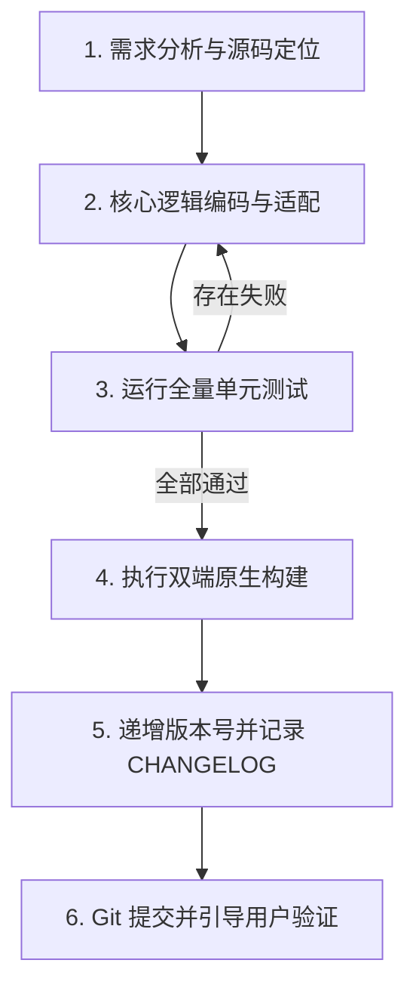

# HistGuard 开发者与智能体开发协作规范 (AGENTS.md)

本文档是 **HistGuard** 项目的核心架构规范、开发流程指南与 Agent 协作准则。任何在此代码库中进行特性开发、缺陷修复或重构的开发者与 AI Agent，均须严格遵守以下约定。

---

## 1. 项目定位与核心设计哲学

* **项目名称**：HistGuard（浏览历史智能防护与隐私卫士）
* **定位**：纯原生、双内核（Chromium MV3 / Gecko MV3）跨浏览器历史记录即时防护扩展。
* **三大底线原则**：
  1. **零外部第三方依赖 (Zero-Dependency)**：严禁引入 Webpack/Vite/Rollup、Tailwind、Lodash、Axios、Jest 等任何运行时或构建打包库。保持纯原生 ESM、原生 DOM/CSS 与原生 Node.js 构建/测试。
  2. **100% 本地离线与极致隐私**：绝不向任何外部服务器发送网络请求（零遥测、零数据上报）。所有规则计算、历史清除与指标统计严格运行在用户本地浏览器沙箱内。
  3. **双内核等价体验 (Chrome & Firefox Parity)**：同一套核心业务逻辑与 UI 代码，通过适配器层无缝支持 Chromium（Chrome/Edge/Brave）与 Gecko（Mozilla Firefox）。

---

## 2. 系统分层架构与目录规范

```text
HistGuard/
├── manifest.chrome.json       # Chromium MV3 扩展清单 (Service Worker 架构)
├── manifest.firefox.json      # Firefox MV3 扩展清单 (Background Script 架构)
├── package.json               # 项目元数据与原生 scripts 脚本
├── build.js                   # 纯原生 Node.js 双端构建脚本
├── CHANGELOG.md               # 严谨详尽的版本更新日志
├── icons/                     # 16/32/48/128/512 全规格科技蓝/翡翠绿状态图标
├── src/
│   ├── adapters/              # 【适配器层】统一抹平 chrome.* 与 browser.* 差异
│   │   ├── IBrowserAdapter.js # 抽象接口基类规范
│   │   ├── ChromiumAdapter.js # Chromium 专用实现 (Promise 化封装)
│   │   ├── FirefoxAdapter.js  # Firefox 专用实现
│   │   └── index.js           # 运行环境自动嗅探与单例导出
│   ├── core/                  # 【核心业务层】纯逻辑与算法 (与 DOM/浏览器解耦，纯可测)
│   │   ├── urlParser.js       # URL 域名逐级解析、TLD 公用后缀、规则候选算法
│   │   ├── ruleMatcher.js     # 正则编译、边界防误杀、通配符与关键词覆盖计算
│   │   ├── storage.js         # 规则增删改查、原子合并落盘、90天滚动裁剪、容错兜底
│   │   ├── historyCleaner.js  # 异步流控分片批量清理、并发节流、Places锁防死
│   │   ├── i18n.js            # 国际化引擎，支持参数插值与动态切换
│   │   ├── theme.js           # 主题解析引擎 (Auto/Dark/Light) 与响应式监听
│   │   └── locales/           # 12 种主流语言多语言字典矩阵
│   ├── background/            # 【后台守护进程】
│   │   ├── index.js           # onVisited/onUpdated 多通道实时拦截与 Alarms 唤醒
│   │   └── toolbarIndicator.js# 科技蓝/翡翠绿工具栏图标与状态指示渲染
│   ├── popup/                 # 【Popup 极简弹窗】(356px 宽度，一键静默/快捷加规)
│   └── options/               # 【Options 控制台】(Tab 导航/历史检索/SVG 趋势图/设置)
├── tests/                     # 【原生单元测试套件】(基于 node:test + node:assert/strict)
└── dist/                      # 【构建产物】(不纳入 Git 版本控制)
    ├── chrome/                # Chromium 已解压扩展分发目录
    └── firefox/               # Firefox 临时附加组件分发目录
```

---

## 3. 关键开发约定与陷阱规范 (Gotchas & Best Practices)

### 3.1 跨端异步存储时序与“原子合并落盘”
* **陷阱**：在 Chrome MV3 中，后台 Service Worker 与前台页面分属不同进程。若连续调用两次 `storage.set`（如先写规则、后写统计），前台收到第一次变动即触发重绘，此时第二次写入尚未落盘，会导致前台数据撕裂（如出现“拦截总数递增但今日拦截为 0”的假象）。
* **规范**：涉及多键联动的存储操作（如 `incrementRuleHits`、`resetRuleHits`），**必须合并为单次原子事务写入**：
  ```javascript
  await browserApi.storage.set({
    [STORAGE_KEYS.RULES]: currentRules,
    [STORAGE_KEYS.STATS]: stats
  });
  ```

### 3.2 Chrome MV3 Service Worker 冷启动竞态防护
* **陷阱**：Chrome Service Worker 在闲置时会自动休眠。唤醒瞬间导航事件已瞬间触发，直接读取模块顶层缓存的配置可能返回初始默认值，导致拦截统计被误判跳过。
* **规范**：后台涉及配置读取必须通过带有未决 Promise 的安全加载器（`getOrFetchSettings()`），确保读取到底层真实持久化数据。

### 3.3 Firefox Places SQLite 单写锁与并发节流
* **陷阱**：Firefox 历史记录数据库 Places 采用单写锁机制。过高的并发删除请求会导致 `database is locked` 报错并引发浏览器卡死。
* **规范**：批量删除必须尊重 `resolveDeleteConcurrency()`。默认保持 `deleteChunkSize: 'auto'`（Chromium 20 并发 / Firefox 6 并发），并在批次间加入微让步流控（`setTimeout(..., 10)`）。修改并发时必须弹窗阻断预警。

### 3.4 本地日历时区对齐 (Local vs UTC)
* **规范**：统计日期键必须通过 `getLocalDateKey(timestamp)` 基于用户计算机本地时区计算 `YYYY-MM-DD`，绝不可直接使用 `toISOString().slice(0, 10)`（会导致东八区等时区清晨跨日错位 8 小时）。落盘时需双轨兼容镜像写入。

### 3.5 规则导入与 ID 防冲突策略 (Auto-Rekeying)
* **规范**：规则去重依据仅认小写表达式（`pattern.toLowerCase()`）。若导入的外部数据出现“ID 相同但域名不同”的冲突情形，程序必须自动为冲突规则分配全新的全局唯一 ID（`rule_${Date.now()}_${random}`），严禁造成多规则同 ID 导致的 DOM/删除功能混乱。

### 3.6 12 种主流语言多语言矩阵 100% 对齐
* **规范**：任何新增或修改的前端文案，必须在 `src/core/locales/` 下所有 12 个语言包中同步补齐对应键值：
  `en`, `zh-CN`, `zh-TW`, `es`, `ar`, `pt`, `id`, `fr`, `ru`, `de`, `ja`, `ko`。
  阿拉伯语（ar）等 RTL 语言需确保排版正常。

---

## 4. 标准开发与交付工作流 (Workflow SOP)

AI Agent 或开发者在承接任务时，应严格遵循以下四步闭环流程：



### 第一步：代码编写与安全边界
* 优先修改 `src/core/` 业务逻辑，并确保逻辑纯粹、无 DOM/扩展 API 强依赖；
* 修改 UI 时确保深浅色主题兼容（使用 CSS 变量）及高质感玻璃拟态风格。

### 第二步：自动化单元测试验证
* 执行全量单元测试（严禁跳过或忽略测试）：
  ```powershell
  & "D:\nodejs\node.exe" --test tests/*.test.js
  ```
* 若涉及新增特性或边缘修复，必须在 `tests/` 下编写新的单元测试断言，确保测试总通过数正向递增，0 fail。

### 第三步：双端生产构建打包
* 运行零依赖构建脚本，自动同步资源并生成 Chrome 与 Firefox 产物：
  ```powershell
  & "D:\nodejs\node.exe" build.js
  ```
* 检查 `dist/chrome` 与 `dist/firefox` 输出文件数量与体积正常。

### 第四步：版本号递增与更新日志
* 修改以下文件中的版本号（遵循 SemVer 规范）：
  - `package.json`
  - `manifest.chrome.json`
  - `manifest.firefox.json`
* 在 [CHANGELOG.md](file:///e:/Workspace/HistGuard/CHANGELOG.md) 顶部追加详细的变更说明，记录**根因分析**、**架构改进**、**防护措施**与**测试覆盖情况**。

### 第五步：Git 提交
* 使用标准约定式提交（Conventional Commits），例如：
  `fix(chrome): fix today hits remaining zero via atomic storage write (v1.0.46)`

---

## 5. 常用环境与维护指令速查

| 操作事项 | 推荐指令 (Windows PowerShell) |
| :--- | :--- |
| **运行全量测试** | `& "D:\nodejs\node.exe" --test tests/*.test.js` |
| **运行单模块测试** | `& "D:\nodejs\node.exe" --test tests/storage.test.js` |
| **执行双端构建** | `& "D:\nodejs\node.exe" build.js` |
| **查看 Git 状态** | `& "d:\Git\cmd\git.exe" status` |
| **提交代码变更** | `& "d:\Git\cmd\git.exe" commit -am "feat(...): ..."` |
| **Chrome 本地调试** | 访问 `chrome://extensions` -> 打开开发者模式 -> 加载已解压的扩展程序 `dist/chrome/` |
| **Firefox 本地调试**| 访问 `about:debugging#/runtime/this-firefox` -> 临时载入附加组件 `dist/firefox/manifest.json` |
